# README

# Business Questions

---

1. Are the complaints grows yearly ? monthly ?
2. Is one issue  growing faster than the others?

# Key Insights

---

### Q1: Are complaints growing yearly? monthly?

**Answer:** No—overall complaints are not growing. Across the full window (2015–2025), the long-term trend fell by 27% with a CAGR of -3.25% per year, and 2025 (-3% YoY) points to leveling off around 133k rather than a new upward cycle.

At the monthly level, complaints are not growing steadily either; they follow a recurring seasonal cycle—peaking in August (+19k), October (+18k), and May (+17k), and dropping lowest in December (-38k) and January (-18k)—with notable irregular spikes ("leftovers") around 2016 and 2018.

**So what:** Volume is not rising now. Investigate what caused the 2018
spike and the 2021 to 2022 drop (policy, reporting, or product changes).

### Q2: Is one issue growing faster than the others?

**Answer:** Yes—the fastest-growing issue shifts depending on your starting baseline. From 2015 onward, "Unwanted calls" dominated both total volume and early growth (shaping the overall 2018 peak and 2023 dip), though its growth has since slowed. When re-indexed to 2019, "Unknown" is the fastest-growing category—climbing to 18.38% of YoY growth in 2020—while "Unwanted calls" has fallen relative to its 2019 level.
**Caveat:**  "Unknown" may be missing labels

**So what:** decompose the "Unwanted calls" and find pattern for those "Unknown" issues . Investigating those will narrow what the the exact issue we should deal with

# Dataset used

---

- Source: CGB - Consumer Complaints Data [[link](https://opendata.fcc.gov/Consumer/CGB-Consumer-Complaints-Data/3xyp-aqkj/about_data)]
- Period: Recorded from 01/01/2015 to 12/31/2025
- Columns:
    
    Ticket_ID
    Ticket_Created
    Date_Created
    Date_of_Issue
    Time_of_Issue
    Form
    Method
    Issue
    Caller_ID_Number
    Type_of_Call_or_Messge
    Advertiser_Business_Number
    City
    State
    Zip
    Location_Center_point_of_the_Zip_Code
    Type_of_Property_Goods_or_Services
    

# Cleaning

---

|  | Action | Rows affected |
| --- | --- | --- |
| duplicates | Delete if exist | 0 (no duplicates) |
| invalid dates | exclude | 754 |
| invalid time | exclude | 2505515 |
| missing date of issue | flag them | 1746511 |
| missing time of issue | flag them | 2020316 |
| missing  *Issue* | name them ‘Unknown’ | 11878 |
| Same issue under two names | Avaibility stuff merged, Interference merged | 183388 |

the results at the new table `complaints_clean` that have only columns: ticket_id, date_of_issue, is_date_missing, issue_cleaned, time_of_issue_cleaned, is_time_missing

those helps to answer problem questions

# Method: Time-series and decomposition

---

checking if there missing months

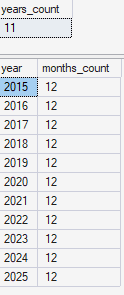

**Query:** [checking months and years count](/sql/check%20missing%20months.sql)

from cleaned data, I create the time-series we will use:

- `ts_monthly_totals` , `ts_yearly_totals`  to analyse the yearly and monthly trends
- `ts_monthly_issue`  to analyse trend per the issue

**Query:** [/sql/creating time-series tables.sql](/sql/creating%20time-series%20tables.sql) 

## Decomposition
---

I split monthly complaints into trend, seasonal and leftover parts using classical decomposition (2x12 moving average)

**Reference:** Hyndman & Athanasopoulos, *Forecasting: Principles and Practice*, [https://otexts.com/fpp2/moving-averages.html](https://otexts.com/fpp2/moving-averages.html).

**Query:** [detereneded data table](/sql/trend%20data.sql) 
>I used deterended data table to get components

**Query:** [components](/sql/ts_components.sql) 

## Trend

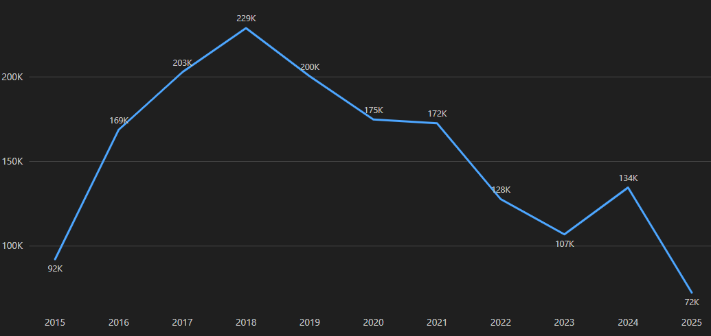

Overall the trend fell 27% from 2015 to 2025
As can be seen from the trend line chart, the trend changed in 4 phases: 
up by 137k complaints in period 2015 to 2018 
downward by 122k in period 2018 to 2023
little up by 27k in a year 2024
in the end go down by 62k complaints 

## Season
---

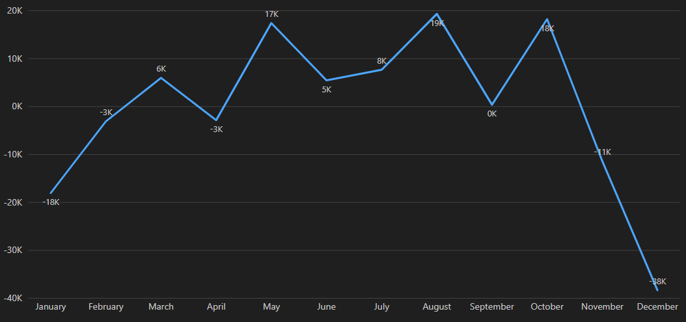

Complaints are higher always in August (19k), May (17k), October (18k) and lowest in January (-18k) and December(-38k)

## Leftovers
---

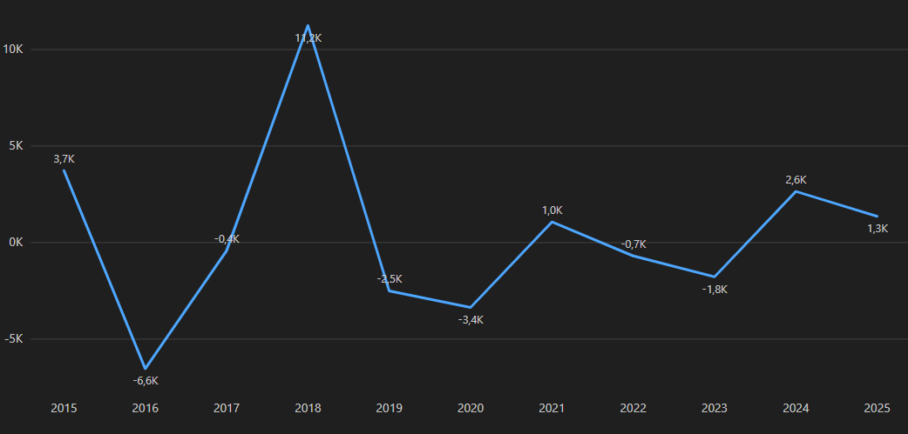

That line chart shows thaere're a lot of unusual values sprcially around 2016 and 2018

# Metrics: CAGR and YoY%
---

## CAGR
Compound Annual Growth Rate (CAGR) can indice to growth where :
    cagr > 0 -> grew overall
    cagr = 0 -> flat overall
    cagr < 0 -> fell overall
>formula: [(endingVal/startVal)^(1/n_years) ] - 1

**Query** : [cagr.sql](sql/cagr.sql)

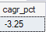

CAGR = -3.25% means that complains fell by about 3.25% per year on average

>Note: CAGR just use ending and start values so doesn't tell   how the time serie is volative 

## YoY% growth
Year over Year growth percent express how a metric changed compared to a year ago :
    yoy > 0 -> grew compared to last year
    yoy = 0 -> flat - no change happened
    yoy < 0 -> fell compared to last year
>formula: (this year − last year) / last year × 100.

**Query** : [yoy.sql](sql/yoy.sql)
>I added the YoY percent as new column in `ts_yearly_total` 

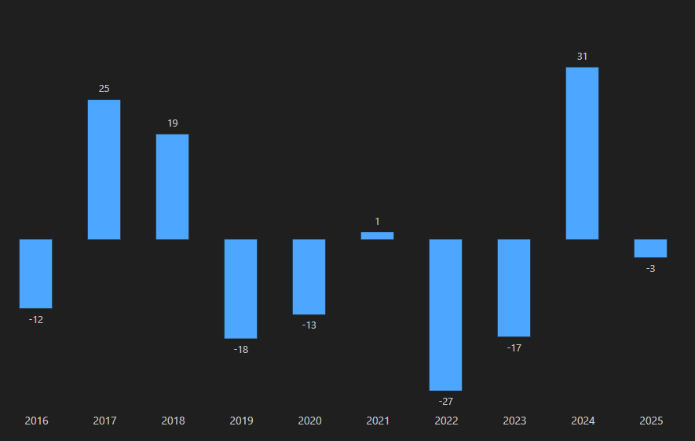

The biggest grew was in 2024, 2017 and 2018. 
looking to the 2024 values (from 105k to 137k) it actually went from the bottom overall
in other side, 2017 was first grew and continue in 2018 to make max complaints overall

The fell start after and it's obvious change (-18% yoy in 2019)
2022 is big difference while complaints  go from 173k to 127k (46k fewer complaints)

The big increases follow low points, so part of each peak is a rebound. 2025 (−3%) suggests complaints have levelled off at around 133k.

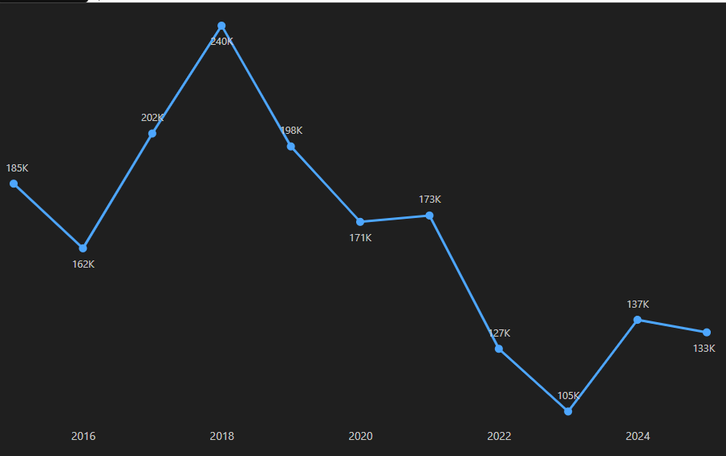

# Issues time series

---

monthly time-series of issues was spaghetti graph

so for make it comparable I aggregate timeline to the years, and use Indexing chart where base date is start date which is here Jan 2015

**Query:** [indexing_chart](/sql/Indexing%20the%20yearly%20ts_issue.sql)
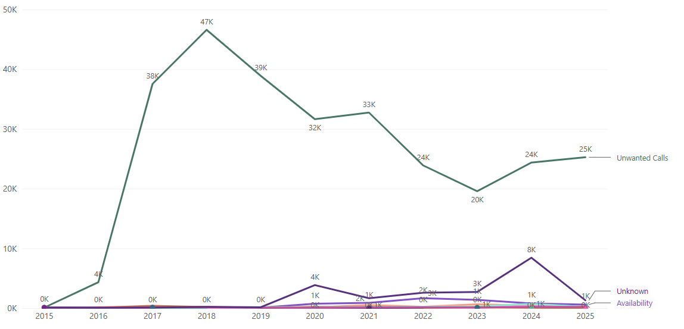

> 
> 
> 
> obviously “Unwanted calls” complaints are in the lead
> 
> we can notice the peaks is same as the trend 2018 rise and 2023 dip, that means trend is totally affected
> 

### YoY

***check the pbi for better look***
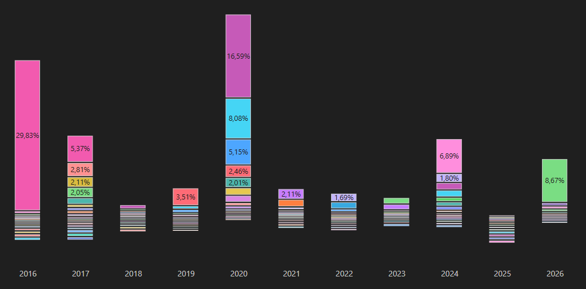
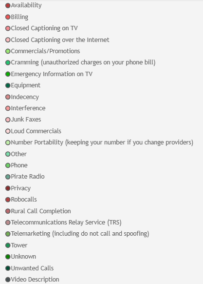

As can be seen from this chart :
- Growing of "Unwanted calls" complaints seems to vanishing , it grew by 33% in 2016. it kept grew but not much 
May I the big grew of 2016 is recording the "Robocalls" and "Telemark" as "Unwanted calls" after october 2016 update
- "Equipement" grew up appears in 2019 (3.89%) and keep in 2020 then just go almost flat
- in 2018 "Unknown" leads the yoy with tiny percent (0.94%) but it go up in 2020 (18.38% from the yoy)

### Changing the base date to 2019 :

**Query:** [indexing_chart](/sql/Indexing%20the%20yearly%20ts_issue.sql)
> Note: uncomment the command: `where YEAR(month) >=2019` comment for 2015 as base year

the lead took by “Unknown” based on values of 2019, means there’re complaining growth in this issue from 2019

“Unwanted Calls” falls too much comparing to its 2019 value but still in the lead

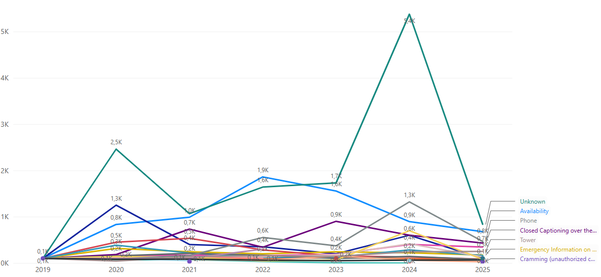

# Limitations and next steps

---
- The dataset I used had 2026 data but as it incompleted year I didn't include it.
- Next questions would solve
3. does the complaints repeat in a pattern like in weekend, or december ?
4. why did complaints (grows/drops) <month>

# Author
---

[SaraMie](https://github.com/SaraMie)
[LinkedIn]([indexing_2019](/screenshots/indexing_chart_base_2019_issue_year.png))

****