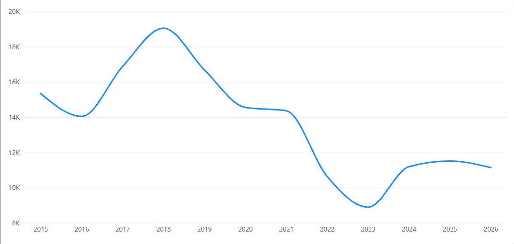

# README

# Business Questions

---

1. Are the complaints grows yearly ? monthly ?
2. Is one issue  growing faster than the others?
3. does the complaints repeat in a pattern like in weekend, or december ?
4. why did complaints (grows/drops) <month>

# Key Insights

---

### Q1: Are complaints growing yearly? monthly?

**Answer:** No. Complaints are not growing steadily: they peaked in 2018,
halved by 2023, and have been flat at about 11k per month since 2024.

**Evidence:**

- Yearly: trend rose +36% (14.0k to 19.1k per month, 2016 to 2018),
fell -53% to 8.9k in 2023, rebounded +26% in 2024, then plateaued.
- Now: 11.1k per month, 42% below the 2018 peak, 25% above the 2023 low.
- Monthly: [seasonal result: highest month, lowest month, size of swing].

**Caveat:** 2026 is a partial year, and trend values at the series ends
(2015, 2026) are less reliable because of the moving average.

**So what:** Volume is not rising now. Investigate what caused the 2018
spike and the 2021 to 2022 drop (policy, reporting, or product changes).

### Q2: Is one issue growing faster than the others?

**Answer:** [Issue X] grew fastest ([+Y%]), while [Issue Z] is the largest
but flat.

**Evidence:**

- Growth: [issue] [+% from year A to B], vs [+% total]
- Share: [issue] went from [a%] to [b%] of total complaints
- Contribution: [issue] explains [c%] of the total change

**Caveat:** [e.g. tiny base, or "Unknown" may be missing labels]

**So what:** [where to focus]

# Dataset used

---

- Source: CGB - Consumer Complaints Data [[link](https://opendata.fcc.gov/Consumer/CGB-Consumer-Complaints-Data/3xyp-aqkj/about_data)]
- Period: Recorded from 01/01/2015 to 12/31/2025
- Columns:
    
    Ticket_ID
    Ticket_Created
    Date_Created
    Date_of_Issue
    Time_of_Issue
    Form
    Method
    Issue
    Caller_ID_Number
    Type_of_Call_or_Messge
    Advertiser_Business_Number
    City
    State
    Zip
    Location_Center_point_of_the_Zip_Code
    Type_of_Property_Goods_or_Services
    

# Cleaning

---

|  | Action | Rows affected |
| --- | --- | --- |
| duplicates | Delete if exist | 0 (no duplicates) |
| invalid dates | exclude | 754 |
| invalid time | exclude | 2505515 |
| missing date of issue | flag them | 1746511 |
| missing time of issue | flag them | 2020316 |
| missing  *Issue* | name them ‘Unknown’ | 11878 |
| Same issue under two names | Avaibility stuff merged, Interference merged | 183388 |

the results at the new table `complaints_clean` that have only columns: ticket_id, date_of_issue, is_date_missing, issue_cleaned, time_of_issue_cleaned, is_time_missing

those helps to answer problem questions

# Metrics: CAGR and YoY%

---

# Method: Time-series and decomposition

---

from cleaned data, I create the time-series we will use:

- `ts_monthly_totals` , `ts_yearly_totals`  to analyse the yearly and monthly trends
- `ts_monthly_issue`  to analyse trend per the issue

**Query:** [/sql/creating time-series tables.sql](https://github.com/SaraMie/Time-series-analysis-with-CGB---Consumer-Complaints-Dataset/blob/main/sql/missing_days.sql) ****

### Plots :

Total complaints per month

Total complaints per year

Issues per month

## Decomposition

---

I split monthly complaints into trend, seasonal and leftover parts using classical decomposition (2x12 moving average)

**Reference:** Hyndman & Athanasopoulos, *Forecasting: Principles and Practice*, [https://otexts.com/fpp2/moving-averages.html](https://otexts.com/fpp2/moving-averages.html).

## Getting trend value

**Query:** [/sql/decomposation time-series.sql](https://github.com/SaraMie/Time-series-analysis-with-CGB---Consumer-Complaints-Dataset/blob/main/sql/decomposation) ****

## Yearly trend

**2015 to 2016 :** falling to about 14k complaints

**2016 to 2017 :** rising from about 14k complaints to about 16k complaints

**2017 to 2018 :** rising from about about 16k complaints to the peak overall about 19.1k complaints 

**2018 to 2019 :** falling from about 19.1k complaints to about 16k complaints

**2019 to 2020 :** continue falling from the 16k complaints to about 14k complaints

**2020 to 2021 :** almost flat down : from 14.6k to 14.4k complaints

**2021 to 2022 :** huge falling (about 4k complaints) from about 14k to 10k complaints

**2022 to 2023 :** falling from about 10k complaints to 8.9k complaints

**2023 to 2024 :** rising from about 8k complaints to about 11k complaints

**2024 to 2025 :** flat up : from about 11.2k complaints to about 11.5k complaints

**2025 to 2026 :** flat down : from about 11.5k complaints to about 11.1k complaints

The main story here is Increased complaints in 2018, and the declining in 2023

## Peaks of the Yearly Trend

### 2018

The peak happen in June with about 19k

### 2023

The dip occurs in May with about 8617

## Season

---

## Leftovers

---

# Issues time series

---

monthly time-series of issues was spaghetti graph

so for make it comparable I aggregate timeline to the years, and use Indexing chart where base date is start date which is here Jan 2015

> 
> 
> 
> obviously “Unwanted calls” complaints are in the lead
> 
> we can notice the peaks is same as the trend 2018 rise and 2023 dip, that means trend is totally affected
> 

### YoY

img: issue_share_in_yoy

img: issue_share_in_yoy_legend

***check the pbi for better look***

the bar chart is share of issue in the yoy, where we can locate that “Unwanted calls” that was 29% of yoy became 0.17%  of 2018 yoy, and we see in this year “Unknown” have biggest share (0.85%), as 2019 “Equipement” issue take 3.51% of yoy 

### Changing the base date to 2019 :

[https://app.notion.com](https://app.notion.com)

the lead took by “Unknown” based on values of 2019, means there’re complaining growth in this issue from 2019

“Unwanted Calls” falls too much comparing to its 2019 value but still in the lead, while the issues : “Availability”, “Phone”, “Closed Captioning over Internet” seems to go down during 2026

img: top_5_indexing_2019

[https://app.notion.com](https://app.notion.com)

# Limitations and next steps

---

****